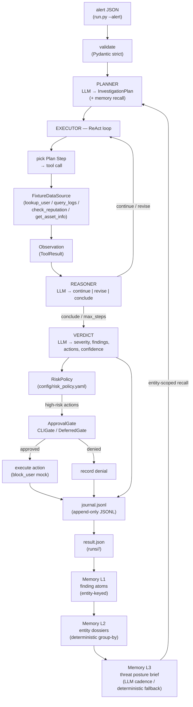

# Alert Triage Agent

An autonomous security-alert triage agent that investigates JSON alerts end-to-end,
produces a structured verdict, and keeps a human in the loop before any high-risk
containment action executes.

Built as a raw-Python system with an explicit Plan → ReAct + replan loop, an
event-sourced run journal, a four-level memory hierarchy, and a two-tier eval harness
— no agent framework.

---

## What and why

Security teams receive alerts (SIEM, CloudTrail, API gateways) faster than humans can
investigate them. Every alert demands the same expensive loop: pull context about the
user, query logs, check reputations, assess the asset — then decide severity and
response. This agent performs that loop autonomously:

- **Zero-touch for benign alerts** — most runs complete with no human input.
- **One approval gate for high-risk actions** — a human approves or denies before
  any containment action executes. Approval can happen interactively (CLI) or
  asynchronously (`--resume --approve|--deny`).
- **Adapts to any alert type** — the planner reads whatever fields exist in the alert
  envelope; new event types need no code changes.
- **Gets smarter across runs** — a four-level memory hierarchy (journal atoms →
  entity dossiers → org-level posture) feeds prior findings back into the planner
  context.

---

## Architecture



### Module map

| Module | Responsibility |
|---|---|
| `run.py` | CLI adapter — `--alert`, `--resume [--approve\|--deny]`, `--synthesize-posture` |
| `src/triage/core.py` | Transport-agnostic `triage(alert, deps)` — orchestrates planner → executor → verdict → gate |
| `src/triage/models.py` | Pydantic contracts: `Alert`, `InvestigationPlan`, `Verdict`, `RunResult`, `GateDecision`, … |
| `src/triage/llm.py` | OpenAI-compatible client — retry ×3 exp backoff + 1 repair attempt on malformed output |
| `src/triage/planner.py` | Alert + memory recall → `InvestigationPlan` (structured LLM) |
| `src/triage/executor.py` | ReAct loop — step → tool → observation → reason; max-steps and repeat-call guards |
| `src/triage/verdict.py` | Findings → structured `Verdict` (LLM); deterministic confidence clamp + action filters |
| `src/triage/journal.py` | Append-only JSONL event emitter + state rebuilder for resume |
| `src/triage/gate.py` | `RiskPolicy` (YAML config) + `ApprovalGate` Protocol + `CLIGate` / `AutoGate` / `DeferredGate` |
| `src/triage/rendering.py` | LLM-facing rendering primitives: truncation, compact JSON, observation tags, prompt split |
| `src/triage/memory/` | L1 atoms, L2 dossiers, L3 posture; entity-scoped recall |
| `src/triage/tools/` | `ToolRegistry` (4 read-only tools), `DataSource` Protocol, `FixtureDataSource`, `block_user` response action |
| `src/triage/evals/` | Runner, 34 golden cases, assertion engine, replay mode, LLM judge |
| `prompts/*.md` | Every LLM prompt (planner, reasoner, verdict, judge, posture) |

Dependency direction: `models` ← everything; `journal` / `llm` / `tools` / `gate` / `rendering`
are leaves consumed by `planner` / `executor` / `verdict`. Nothing imports `run.py`.

---

## Setup

### Requirements

- Python 3.11+
- [uv](https://github.com/astral-sh/uv) — used for all dependency management and running

### Install

```bash
git clone <repo>
cd alert-triage-agent
uv sync
```

### Environment

Copy `.env.example` to `.env` and fill in your values:

```bash
cp .env.example .env
```

| Variable | Default | Description |
|---|---|---|
| `LLM_API_KEY` | *(required)* | API key for any OpenAI-compatible provider |
| `LLM_BASE_URL` | `https://api.openai.com/v1` | Provider base URL — swap for DeepSeek, Ollama, vLLM, OpenRouter, etc. |
| `LLM_MODEL` | `gpt-4o-mini` | Model name sent to the provider |
| `MAX_STEPS` | `15` | Maximum executor steps per run; graceful termination on breach |
| `MEMORY_DIR` | `.memory` | Base directory for L1/L2/L3 memory artifacts (gitignored) |
| `MEMORY_SYNTHESIZE_EVERY_N_RUNS` | `0` | Regenerate the L3 posture brief every N runs; `0` = disabled (use `--synthesize-posture` for on-demand) |
| `RISK_POLICY_PATH` | `config/risk_policy.yaml` | Path to the risk policy YAML that classifies actions as high/low risk |

`runs/` (runtime artifacts) and `.env` are gitignored. No secrets ever reach the repo.

---

## Running

### Single alert (the primary mode)

```bash
# Data-exfiltration sample alert
make run

# Privilege-escalation sample alert
make run ALERT=alerts/ALT-2026-04-7835-privilege-escalation.json

# Any custom alert JSON
make run ALERT=path/to/your-alert.json
```

This prints a human-readable verdict summary and writes the versioned run record to
`runs/<run_id>/result.json`.

### Resume flow (asynchronous approval)

When the agent reaches a high-risk verdict in a non-interactive context (or exits mid-run),
it parks the run as `awaiting_approval`. Resume it with:

```bash
# Approve the pending high-risk action batch
uv run python run.py --resume <run_id> --approve

# Deny the pending high-risk action batch
uv run python run.py --resume <run_id> --deny

# Continue an interrupted investigation (killed mid-run, no gate yet)
uv run python run.py --resume <run_id>
```

The `run_id` appears in the summary printed at the end of each run and in
`runs/<run_id>/` on disk.

### On-demand L3 posture synthesis

```bash
uv run python run.py --synthesize-posture
```

Regenerates the org-level threat posture brief immediately, regardless of the cadence
configured by `MEMORY_SYNTHESIZE_EVERY_N_RUNS` (including when it is `0`). The brief
is written to `$MEMORY_DIR/posture.md`. This path is key-free — it uses the
deterministic fallback (top-N atom aggregation) without an LLM call.

---

## Evals

The eval harness is the functional acceptance gate — a prompt change that breaks a
golden case does not ship.

### Two tiers

**Tier 1 — blocking behavioral assertions** (`make eval-replay` / `make eval`):
Each of the 34 golden cases (`src/triage/evals/cases/*.yaml`) asserts on:
- Trajectory: required tools called, gate-before-high-risk ordering, max-steps
  respected, no repeated identical calls.
- Verdict: severity in the allowed range, entities referenced, confidence floor,
  schema validity.

Ranges are used, not exact matches — LLM output varies run to run.

**Tier 2 — advisory LLM judge** (embedded in `make eval`):
Scores reasoning quality from the run trace using a median-of-3 call strategy (three
independent judge calls, median score taken) to reduce noise. Tracked as a trend;
never blocks. Only Tier-1 carries acceptance weight.

### Running evals

```bash
# Replay mode — deterministic, key-free, CI-safe (uses cached LLM responses)
make eval-replay

# Live mode — real LLM calls (requires .env with LLM_API_KEY)
make eval
```

Replay mode uses prompt-hash-keyed cached responses stored in `.replay.json` files
alongside each case. When you change a prompt, the cache misses, forcing fresh LLM
calls; then re-record with:

```bash
uv run python -m triage.evals.runner --record
```

This re-runs all cases live and writes new `.replay.json` caches.

### Golden case coverage

34 cases span the core behavioral envelope:

| Category | Cases |
|---|---|
| Confirmed threat (data exfil, priv-esc) | `exfil-prod`, `priv-esc` |
| Benign / false-positive discipline | `benign`, `benign-after-flagged`, `benign-*` (7 variants) |
| Unknown event type (zero code changes needed) | `unknown-event-type` |
| Tool failure handling | `tool-failure`, `tool-failure-*` (4 variants) |
| Edge cases | `edge-contradictory-signals`, `edge-empty-entities`, others |

---

## Assumptions

As decided on 2026-06-05 (PRD-0001 §Assumptions):

1. **Approved actions execute immediately.** The agent executes mock containment
   actions (e.g. `block_user`) right after approval; denial is recorded and the
   verdict still ships.
2. **The reviewer grades with their own LLM key.** The LLM client is
   OpenAI-compatible — provider, base URL, and model are pure configuration (`.env`).
   Swapping in DeepSeek, Ollama, or vLLM is configuration, not code.
3. **"High-risk" classification is owned by `config/risk_policy.yaml`**, defaulting
   to conservative (unclassified = high-risk). The LLM never decides what is
   high-risk.
4. **One approval gate per run.** All high-risk actions in a verdict are batched into
   a single approval request. Per-action and tiered gates are roadmap (the
   `ApprovalGate` Protocol is the extension seam).

---

## Trade-offs and what I would do differently

### LangGraph (or any agent framework) — why rejected

LangGraph was considered and rejected (ADR-0001). Its checkpointing is an opaque
state snapshot rather than an audit-grade journal, its tracing assumes LangSmith, and
it would replace only the cheapest part of the system (the ~100-line loop) while
hiding the architecture skill the rubric weighs at 30%. The hand-rolled loop is
transparent: the journal, the ReAct dispatch, and the gate are all plain Python that
a reviewer can read in one sitting. Revisit when durable multi-node execution or team
standardization matters.

### Workflow/playbook router — deliberately excluded

A predefined tool-sequence router per known event type would reduce token cost. It was
rejected because a fixed sequence directly violates "use output from one tool to
decide what to do next." Recorded as a roadmap note: a hybrid router (standardized
lanes for very high-volume known types, agentic fallback for everything else) is the
production optimization, but not for a rubric that weights reasoning at 20%.

### Connector roadmap (fixture world → real integrations)

The four investigation tools (`lookup_user`, `query_logs`, `check_reputation`,
`get_asset_info`) currently run against a consistent fixture world. The `DataSource`
Protocol is the seam: real connectors (Splunk, Okta, VirusTotal, AWS IAM, CMDB) drop
in behind it. The `ToolError(transient|permanent)` contract already handles the retry
semantics real integrations need.

### Production HITL (CLI gate → ticketing/Slack)

The current `CLIGate` blocks on stdin. Production needs `DeferredGate` (already
shipped for watch mode) wired to a ticketing system or a Slack approval workflow:
the run exits `awaiting_approval`, the approval surface sends `--resume --approve|--deny`
back on confirmation. The `ApprovalGate` Protocol is the extension seam — no core
changes needed.

### Watch mode — cut this wave, design sketch

Watch mode (`--watch <dir>`) was cut from wave 4 scope (the RFC-0001 sanctioned cut
line). The system shipped is event-driven via `--alert`. To add watch mode:

1. Add a file-system watcher (e.g. `watchdog`) that detects new `.json` files in the
   drop folder.
2. For each file: mint a `run_id`, call `_run_fresh()` with `interactive=False`, which
   wires `DeferredGate` — a high-risk verdict exits as `awaiting_approval` instead of
   blocking on stdin.
3. The operator runs `python run.py --resume <run_id> --approve|--deny` to complete
   the gate. The journal is the state; no extra database is needed.
4. Serial ingestion (one run at a time) preserves the single-writer journal/memory
   posture. Concurrent ingestion (parallel runs writing to shared memory) is a later
   locking/partitioning problem.

The `DeferredGate` and resume machinery are already production-ready. Watch mode is
a thin adapter loop, not a core change.

---

## Requirements traceability

| PRD requirement | Where satisfied |
|---|---|
| Receive alert as JSON (stable envelope) | `models.Alert` (Pydantic strict) — `src/triage/models.py` |
| LLM reasoning — not hardcoded; new event types adapt | `planner.py` + `prompts/planner.md`; no `event_type` branching anywhere |
| ≥3 mock tools with realistic data | `src/triage/tools/registry.py` (`lookup_user`, `query_logs`, `check_reputation`, `get_asset_info`) + `tools/fixtures/` |
| Chain reasoning: each output feeds next decision | `executor.py` ReAct loop; `prompts/reasoner.md` consumes all prior observations |
| Structured verdict: severity, findings, actions, confidence | `models.Verdict`; `verdict.py`; US-0001 AC |
| Human-in-the-loop gate before high-risk action | `gate.py` — `RiskPolicy` + `CLIGate`; `core.py` enforces ordering |
| Python 3.11+, ≥1 real LLM call | `pyproject.toml` `requires-python = ">=3.11"`; `@pytest.mark.live` tests (US-0001) |
| Configurable max steps with graceful termination | `MAX_STEPS` env; `executor.py`; `tests/test_executor.py:test_max_steps_*` |
| ≥3 tests (tool call / approval gate / tool error) | `tests/test_core.py`, `tests/test_executor.py`, `tests/test_verdict.py` |
| Run journal (audit trail, resume, retry visibility) | `journal.py` + `ADR-0003`; US-0002 |
| Memory L0→L3 (entities, dossiers, posture) | `src/triage/memory/`; US-0003, US-0004 |
| Two-tier eval harness (blocking + advisory judge) | `src/triage/evals/`; 34 golden cases; US-0003 AC |
| README + `.env.example` + `pyproject.toml` | This file; repo root |
| No secrets in repo | `.gitignore` covers `runs/`, `.env`, `.memory/`; `.env.example` has only placeholders |
| Single-command run | `make run` |
